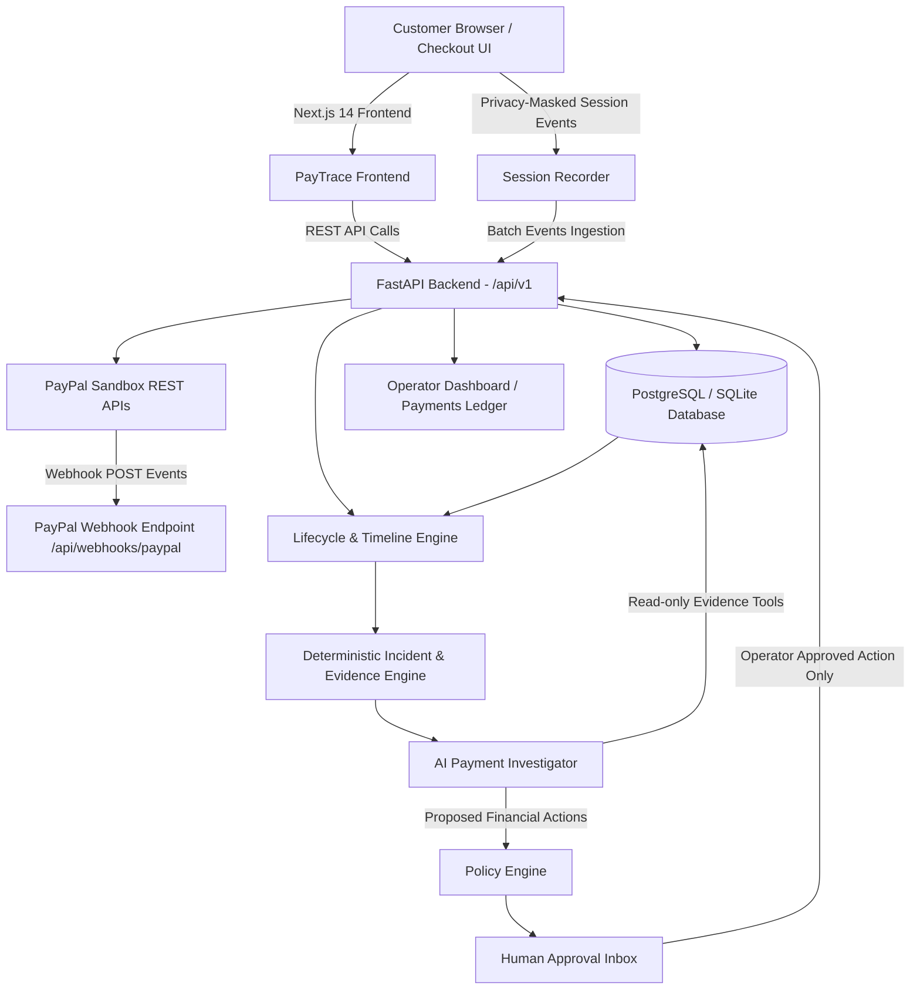

# PayTrace

> **Don't just know a payment failed. Know exactly why.**

PayTrace is an AI-powered payment investigation and observability platform for applications accepting payments through PayPal. It correlates PayPal orders, captures, verified webhooks, application lifecycle events, and customer checkout sessions into a single, unified payment journey.

An evidence-grounded AI investigator explains root causes, cites supporting facts, identifies related failures, estimates potential revenue at risk, and recommends safe next actions.

---

## 🌟 Key Features

1. **Cross-Signal Payment Lifecycle**
   - Correlates frontend interaction events, PayPal REST API requests/responses, and verified webhooks into an append-only chronological timeline.
   - Preserves out-of-order and delayed webhooks without regressing final payment state.
   - Visually and programmatically distinguishes genuine PayPal events from simulated demo data.

2. **AI Payment Investigator with Safe Fallbacks**
   - Performs root-cause analysis backed by structured, redacted database evidence.
   - Clearly separates **FACT**, **INFERENCE**, and **RECOMMENDATION** in every diagnosis.
   - Operates in offline mode with a deterministic rule-based investigation engine if AI API keys are not supplied.

3. **Critical Timeout Ambiguity Detection**
   - Detects the e-commerce scenario where PayPal captures a payment but the merchant backend times out before receiving the HTTP 200 response.
   - Marks the payment state as `CAPTURE_UNCERTAIN` and explicitly advises **reconciliation before retry** to prevent double-charging buyers.

4. **Incident Detection & Potential Revenue at Risk**
   - Evaluates deterministic failure rules (capture timeout spikes, decline surges, webhook delays).
   - Groups affected payments, calculates potential revenue at risk (without misrepresenting it as confirmed loss), and generates AI diagnostic reports.

5. **Human-in-the-Loop Financial Safety Inbox**
   - Sensitive financial actions (refunds) require explicit operator review.
   - Neither AI agents nor simulators can execute irreversible transactions without human sign-off.

6. **PayPal Checkout & ShelfSwipe Demo Catalog**
   - `/checkout` runs the PayPal approval and capture flow. `/shelfswipe` provides a clearly labelled sample product catalog for local checkout testing.

---

## 🏗️ Architecture & Technology Stack



- **Frontend**: Next.js 14 (App Router), TypeScript, Tailwind CSS, Lucide React, Recharts.
- **Backend**: Python 3.11+, FastAPI, Pydantic v2, SQLAlchemy 2.x, Alembic, httpx.
- **Database**: PostgreSQL (Production/Docker) with automatic fallback to SQLite for zero-setup local development.
- **PayPal Integration**: Official PayPal Sandbox REST v2 APIs + built-in credential-free `MockPayPalSandbox`.
- **AI Engine**: OpenAI-compatible provider + deterministic evidence-based fallback engine.

---

## 📁 Repository Structure

```text
paytrace/
├── frontend/                     # Next.js 14 TypeScript Frontend
│   ├── app/                      # App router pages (dashboard, payments, incidents, checkout, ShelfSwipe, etc.)
│   ├── components/               # Layout, headers, navigation, and visual panels
│   ├── lib/                      # Type-safe API client and data contracts
│   └── .env.example              # Frontend environment template
├── backend/                      # Python FastAPI Backend
│   ├── app/
│   │   ├── main.py               # FastAPI entrypoint, middleware, routers
│   │   ├── api/routes/           # Versioned API routes (/api/v1) and webhooks
│   │   ├── agents/               # AI Investigator & server-side evidence tools
│   │   ├── core/                 # Settings, security redaction, logging, time helpers
│   │   ├── db/                   # SQLAlchemy models, session factory, base
│   │   ├── schemas/              # Pydantic v2 request & response validation schemas
│   │   └── services/             # PayPal client, mock sandbox, lifecycle, policy, detector
│   ├── migrations/               # Alembic versioned migrations
│   ├── scripts/                  # Seed demo script & CLI scenario simulator
│   ├── tests/                    # Pytest test suite (11 unit & integration tests)
│   └── .env.example              # Backend environment template
├── docs/                         # Extended documentation
│   ├── architecture.md           # System architecture & trust boundaries
│   ├── paypal-setup.md           # PayPal developer portal setup & webhook tunneling
│   ├── ai-investigator.md        # AI investigation design & evidence tools
│   └── demo-script.md            # 3-minute hackathon presentation script
├── postman/                      # Postman collection for reproducible API requests
│   └── PayTrace.postman_collection.json
├── docker-compose.yml            # Multi-container orchestration (PostgreSQL, Backend, Frontend)
├── LICENSE                       # MIT License
└── README.md
```

---

## 🚀 Quick Start Guide

You can run PayTrace using **Docker Compose** or directly on your **local machine**.

### Option A: Running with Docker Compose (Recommended)

1. **Clone the repository:**
   ```bash
   git clone https://github.com/khushi-upadhyay/PayTrace.git
   cd PayTrace
   ```

2. **Start all services:**
   ```bash
   docker-compose up --build
   ```

3. **Access the applications:**
   - **Frontend Dashboard**: [http://localhost:3000](http://localhost:3000)
   - **FastAPI OpenAPI Docs**: [http://localhost:8000/docs](http://localhost:8000/docs)
   - **PostgreSQL**: `localhost:5432` (credentials: `postgres` / `postgrespassword`)

---

### Option B: Running Locally

#### 1. Backend Setup (FastAPI & Python 3.11+)

1. Navigate to `backend` and set up a virtual environment:
   ```bash
   cd backend
   python -m venv .venv
   ```

   **Activate virtual environment:**
   - On Windows:
     ```powershell
     .venv\Scripts\activate
     ```
   - On macOS/Linux:
     ```bash
     source .venv/bin/activate
     ```

2. Install dependencies:
   ```bash
   pip install -r requirements.txt
   ```

3. Configure environment variables:
   ```bash
   cp .env.example .env
   ```
   *(Note: By default, if no PostgreSQL or PayPal credentials are provided, PayTrace runs out of the box using SQLite and Mock Sandbox!)*

4. Apply database migrations:
   ```bash
   alembic upgrade head
   ```

5. Seed the demo records on a fresh database (the command skips if existing payment, event, webhook, session, incident, or approval data is present):
   ```bash
   python scripts/seed_demo.py
   ```

6. Start the FastAPI development server:
   ```bash
   uvicorn app.main:app --reload --host 0.0.0.0 --port 8000
   ```
   The backend API is available at [http://localhost:8000](http://localhost:8000) (Interactive Swagger Docs at [http://localhost:8000/docs](http://localhost:8000/docs)). The frontend root redirects to `/dashboard`; see [the route inventory](docs/routes.md).

---

#### 2. Frontend Setup (Next.js 14)

1. In a new terminal, navigate to `frontend`:
   ```bash
   cd frontend
   ```

2. Install dependencies:
   ```bash
   npm install
   ```

3. Configure environment variables:
   ```bash
   cp .env.example .env.local
   ```

4. Start the Next.js development server:
   ```bash
   npm run dev
   ```
   Open [http://localhost:3000](http://localhost:3000) in your browser.

---

## 🧪 Testing

### Running Backend Unit & Integration Tests

PayTrace includes an automated test suite verifying lifecycle transitions, webhook idempotency, timeout detection, incident thresholding, privacy masking, and approval workflows:

```bash
cd backend
python -m pytest tests -v
```

**Test Coverage Summary:**
- `test_approvals.py`: Human-in-the-loop approval and policy enforcement.
- `test_health.py`: Health and readiness probe (`/api/v1/health`).
- `test_incidents.py`: Deterministic incident threshold detection and diagnostic report generation.
- `test_investigation.py`: Critical timeout ambiguity investigation and duplicate-charge prevention advice.
- `test_payments.py`: Payment creation and ledger querying.
- `test_timeline.py`: Unified chronological event sequence reconstruction.
- `test_webhooks.py`: Webhook signature verification and idempotency deduplication.
- `test_sessions.py`: Browser session recording and automatic PII/credential redaction.
- `test_analytics.py`: Performance metrics, latency stats, and revenue-at-risk aggregation.
- `test_settings.py`: Safe integration disclosure without credential leakage.
- `test_demo.py`: Demo scenarios and clean database re-seeding.

### Validating Frontend Production Build

```bash
cd frontend
npm run build
```

---

## 💳 PayPal Developer Sandbox Integration & Setup

PayTrace integrates directly with the official PayPal Sandbox REST v2 APIs and Webhooks while preserving zero-setup mock fallback when credentials are not supplied.

### 1. PayPal Developer Sandbox Configuration

1. Log in to the [PayPal Developer Dashboard](https://developer.paypal.com/dashboard).
2. Go to **Apps & Credentials** and select the **Sandbox** toggle.
3. Click **Create App**:
   - **App Name**: `PayTrace-Sandbox`
   - **App Type**: `Merchant`
4. Copy the **Client ID** and **Secret**.
5. Check your default Sandbox accounts under **Testing Tools > Sandbox Accounts**:
   - **Personal Account** (Buyer): e.g. `sb-buyer@personal.example.com` (note password for checkout approval).
   - **Business Account** (Merchant): e.g. `sb-facilitator@business.example.com`.

### 2. Environment Variables Configuration

In `backend/.env` (or root `.env`):

```bash
PAYPAL_MODE=sandbox
PAYPAL_CLIENT_ID=your_sandbox_client_id_here
PAYPAL_CLIENT_SECRET=your_sandbox_client_secret_here
PAYPAL_WEBHOOK_ID=your_registered_webhook_id_here
```

> **Security Note:** Secrets are strictly server-side. Never set secrets in `frontend/.env.local` or expose them to `NEXT_PUBLIC_*` variables.

### 3. Exposing Webhooks via HTTPS Tunnel (ngrok / localtunnel)

PayPal Sandbox webhooks require a publicly accessible HTTPS endpoint to deliver events.

1. Start your backend on port 8000:
   ```bash
   uvicorn app.main:app --port 8000
   ```
2. Start an HTTPS tunnel:
   ```bash
   ngrok http 8000
   ```
   *(Copy the forwarding HTTPS URL, e.g., `https://abcdef123456.ngrok-free.app`)*
3. In PayPal Developer Dashboard:
   - Navigate to your Sandbox App.
   - Click **Add Webhook**.
   - **Webhook URL**: `https://abcdef123456.ngrok-free.app/api/v1/webhooks/paypal`
   - **Event Types to subscribe**:
     - `CHECKOUT.ORDER.APPROVED`
     - `PAYMENT.CAPTURE.PENDING`
     - `PAYMENT.CAPTURE.COMPLETED`
     - `PAYMENT.CAPTURE.DENIED`
     - `PAYMENT.CAPTURE.REFUNDED`
4. Save the webhook and copy the generated **Webhook ID**.
5. Set `PAYPAL_WEBHOOK_ID=<your-webhook-id>` in your backend `.env` file.

---

## 🎬 Step-by-Step Verification Procedure

### A. End-to-End Sandbox Checkout
1. Open **PayPal Checkout** at [http://localhost:3000/checkout](http://localhost:3000/checkout). The separate sample catalog is at [http://localhost:3000/shelfswipe](http://localhost:3000/shelfswipe).
2. Select a demo item (e.g. `$49.99 Developer Cloud License`).
3. Select **Standard Successful Payment** and click **Pay with PayPal Sandbox**.
4. With Sandbox credentials, approve the order in PayPal and return to PayTrace. In credential-free demo mode, the local approval screen asks you to explicitly simulate buyer approval; it does not contact PayPal or move money.
5. PayTrace verifies the provider order status before requesting capture.
6. The backend captures the payment with PayPal, records the timeline event, and displays the **`CAPTURED`** status.
7. Click **Inspect Lifecycle in PayTrace** to view the event trace. A webhook entry appears only after an actual signature-verified Sandbox webhook delivery:
   - `CHECKOUT_ORDER_CREATED`
   - `CHECKOUT_ORDER_APPROVED`
   - `CAPTURE_COMPLETED`
   - A webhook event only when an actual, signature-verified PayPal delivery is received.

### B. Investigating Failure & Timeout Scenarios
1. On the `/checkout` page, select **Merchant Backend Timeout / Ambiguous Capture State** or click **Simulate Timeout** in the header.
2. Complete checkout: the payment enters **`CAPTURE_UNCERTAIN`**.
3. Click **Investigate with AI**:
   - The AI investigator builds a chronological timeline from real database records.
   - Shows **Facts** (order created, capture sent, timeout before 200 OK) vs **Inferences** (PayPal may have captured funds; blind retry prohibited).
   - Recommends **Reconciliation before retry** to avoid duplicate charges.

---

## 🔒 Security & Privacy

- **Zero Secret Exposure**: No PayPal client secrets or AI keys are ever transmitted to the frontend or exposed in API responses.
- **Privacy Masking**: Browser interaction sessions redact credit card numbers, passwords, CVV, and authentication tokens before storage.
- **Human Approval**: Consequential money movements (such as refunds) cannot be executed by AI agents; they require explicit human approval via `/approvals`.
- **Honest Evidence Boundaries**: Simulated events are tagged with `source_mode="SIMULATED"` and visibly labelled in the UI.

---

## 📄 License

This project is licensed under the MIT License - see the [LICENSE](LICENSE) file for details.
