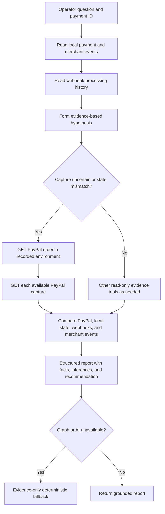

# PayTrace AI Investigation Flow

PayTrace uses LangGraph to coordinate read-only evidence tools. SQL and provider APIs establish facts; the model explains those facts, separates inference from observation, and recommends safe next steps. The agent cannot capture, refund, or retry a payment.

## Per-payment flow

### Evidence tools

- `get_payment_facts`: local payment state, provider IDs, source mode, and recorded merchant lifecycle events.
- `get_paypal_order`: live `GET /v2/checkout/orders/{id}` in the same PayPal environment that created the payment. If the payment is simulated, it is clearly labeled and reads only the in-memory demo provider.
- For capture IDs returned by PayPal or already recorded locally, `get_paypal_order` also makes a live `GET /v2/payments/captures/{id}` and returns only status, amount, currency, and timestamps.
- `inspect_webhook_events`: signature and processing status, event type, and receive time for linked webhook history. Missing webhook records do not prove PayPal failed to send a webhook.
- `inspect_payment_timeline`: ordered backend and provider lifecycle events, source, status, latency, and simulation marker.
- `find_similar_failures`, `compare_successful_payments`, and `analyze_failure_patterns`: bounded local database comparisons.
- `get_incident_overview`: SQL grouped counts for payment statuses and failure patterns, prior-window comparison, event latency grouped by source, webhook processing status, and reconciliation candidates.

An uncertain capture always triggers a provider order lookup even if the model proposes another tool. A live capture is considered confirmed only when the live PayPal response reports a completed order and completed capture. When the provider API is unavailable, the report says the provider state is unconfirmed and recommends reconciliation before retry.

## Fleet-level Incident Command

`POST /api/v1/ai/investigate` accepts a question without `payment_id` or `incident_id` to investigate recent fleet activity. The default window is 15 minutes; a question such as “last 30 minutes” selects the SQL window. SQL compares the current interval with the immediately preceding interval of the same length. LangGraph then analyzes these retrieved aggregates. Report counts and comparison values are rendered from SQL results, never generated by the language model.

Examples:

- “Why did checkout failures increase in the last 15 minutes?”
- “Which failure pattern affects the most transactions?”
- “Are failures related to PayPal API latency or merchant backend errors?”
- “Which transactions require reconciliation?”

The aggregate path compares event latency by recorded event source with webhook processing counts. Those records can support a correlation; they do not alone prove that PayPal caused a merchant-side failure.

## LangSmith tracing

Set `LANGCHAIN_API_KEY` or `LANGSMITH_API_KEY` and optionally `LANGCHAIN_PROJECT` in `backend/.env`. When a key is present, tracing is enabled by default. Set `LANGSMITH_TRACING=false` (or `LANGCHAIN_TRACING_V2=false`) to disable it explicitly. LangGraph runs are named `PayTrace payment investigation` and `PayTrace incident command` and tagged by flow for filtering in LangSmith. The application continues to work without a LangSmith key.

## Fallback order

1. LangGraph with configured AI provider and retrieved tools.
2. LangGraph with deterministic analysis/reporting when the model key is absent or the model call fails.
3. SQL evidence-only incident summary if LangGraph is unavailable.
4. Existing deterministic per-payment evidence report if LangGraph or model execution fails.

No fallback invents a PayPal response. Missing credentials or unreachable Sandbox APIs are reported as unavailable/demo evidence.

## APIMatic PayPal Context Plugin

APIMatic's PayPal Context Plugin is a coding-agent development aid. Its marketplace page lists nine integration skills (getting started, integration guide, authentication, client setup, endpoints, models, error handling, resilience, and testing) and generated SDK context. It is not a deployed runtime service. Use it during development with `npx context-plugins install paypal`; PayTrace runtime continues to use its own PayPal REST client and official PayPal API responses. No APIMatic runtime dependency or fabricated documentation results are added.

References: [APIMatic PayPal API Context Plugin](https://context.apimatic.io/plugins/paypal/) · [PayPal Orders API](https://developer.paypal.com/docs/api/orders/v2/) · [PayPal Payments API](https://developer.paypal.com/docs/api/payments/v2/).
