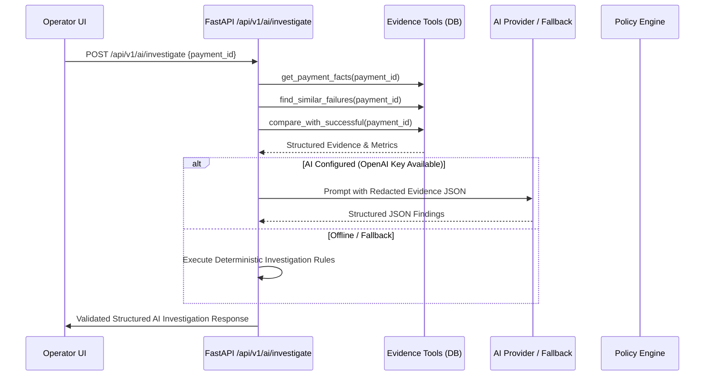

# PayTrace AI Payment Investigator

The AI Payment Investigator is not a chatbot wrapper; it is a cross-signal root-cause analysis engine that gathers deterministic facts across the payment provider, backend lifecycles, and customer browser sessions.

## Investigation Workflow



## Bounded Evidence Tools

The investigator uses server-side read tools to gather facts:
1. `get_payment_facts(payment_id)`: Fetches payment lifecycle status, provider order ID, capture ID, webhook reception count, and latency metrics.
2. `find_similar_failures(payment_id)`: Identifies payment failures occurring within the same time window sharing identical failure codes or decline reasons.
3. `compare_with_successful(payment_id)`: Compares the problematic payment with a successful payment of similar size to pinpoint divergence points.
4. `get_session_summary(payment_id)`: Evaluates user activity preceding the failure marker.

## Structured Output Schema

Every investigation produces a strictly validated Pydantic model:
```json
{
  "root_cause": "Merchant backend timed out while awaiting PayPal capture response; final capture outcome is unconfirmed locally.",
  "confidence": 0.94,
  "severity": "HIGH",
  "facts": [
    "PayPal order MOCK-ORD-TIMEOUT-001 was successfully created and approved by the buyer.",
    "The merchant backend dispatched a capture request to PayPal.",
    "Merchant HTTP client timed out (>5000ms) before receiving the HTTP capture response.",
    "No verified PAYMENT.CAPTURE.COMPLETED webhook was processed prior to timeout.",
    "Payment marked CAPTURE_UNCERTAIN to prevent premature retry."
  ],
  "inferences": [
    "PayPal may have successfully processed the capture on their ledger despite the local HTTP timeout.",
    "A blind capture retry risks duplicate charges on the customer's payment instrument."
  ],
  "customer_impact": "Customer observed a connection timeout spinner; funds may have been debited or reserved without local confirmation.",
  "business_impact": "Potential revenue at risk of $189.99 USD. High dispute risk if double-captured.",
  "recommendation": "DO NOT RETRY CAPTURE. Reconcile order state via GET /v2/checkout/orders/{order_id} or verify incoming webhooks before taking further action.",
  "evidence_event_ids": ["evt-1", "evt-2"],
  "is_incident_likely": true,
  "insufficient_evidence": false,
  "model_name": "deterministic-rule-engine-v1"
}
```

## Critical Principle: Distinguishing Facts vs. Inferences
- **Facts**: Concrete, observable events recorded in the database (e.g. "Order approval was recorded", "HTTP read timeout occurred after 5.2s").
- **Inferences**: Probabilistic hypotheses derived by the AI from the evidence (e.g. "Capture may have succeeded at provider").
- **Recommendations**: Safe operational next steps (e.g. "Reconcile order state before retrying").

## Safeguards & Human Approval
The AI Investigator **cannot execute financial transactions autonomously**. Proposing a refund generates an approval ticket routed to the Human Approval Inbox (`/approvals`), requiring explicit human sign-off before executing.
