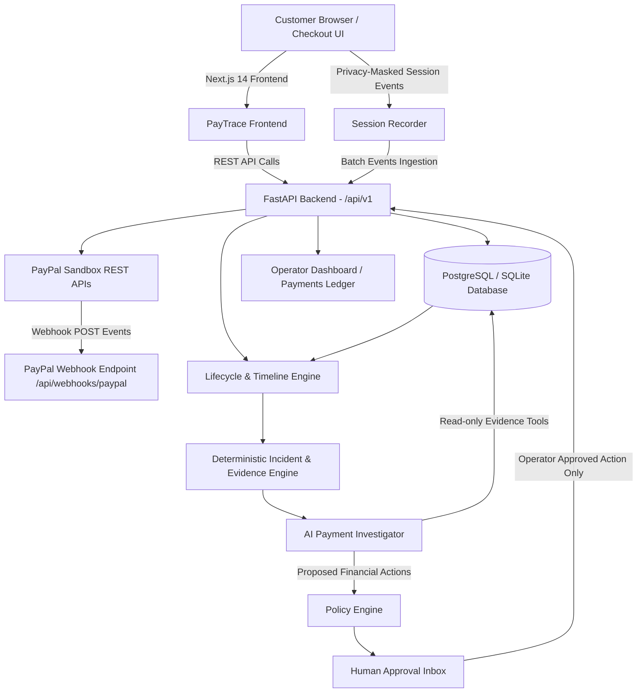

# PayTrace System Architecture

PayTrace is an AI-powered payment investigation and observability platform for applications accepting payments via PayPal. It correlates PayPal orders, captures, verified webhooks, merchant application lifecycle events, and customer checkout-session recordings into a unified payment journey.

## High-Level Architecture Diagram



## Core Components

### 1. Frontend (Next.js 14 App Router)
- **Framework**: Next.js, React 18, TypeScript, Tailwind CSS, Lucide icons, Recharts.
- **Pages**:
  - `/` Landing page highlighting cross-signal payment observability.
  - `/dashboard` Real-time payment metrics, success/failure rates, potential revenue at risk, latency graphs, and open incidents.
  - `/payments` Filterable and searchable ledger of payments with real/simulated markers.
  - `/payments/[id]` Deep payment detail view with chronological unified timeline, AI investigator analysis, session replay, and refund trigger.
  - `/incidents` Diagnostic incident view grouping related failure spikes with automated diagnostic reports.
  - `/investigate` Dedicated AI investigation console with multi-turn query capabilities.
  - `/approvals` Human-in-the-Loop inbox for reviewing and approving high-risk financial actions (refunds).
  - `/analytics` Performance breakdown, payment volume, latency SLA tracking, and failure distributions.
  - `/checkout` Interactive demo store with product catalog and PayPal checkout simulator.
  - `/settings` Configuration and integration status dashboard without exposing secrets.

### 2. Backend (FastAPI Python 3.11+)
- **API Engine**: Versioned REST API under `/api/v1` with centralized error handling, structured logging, and CORS middleware.
- **Database Layer**: SQLAlchemy 2.x ORM with versioned Alembic migrations. Supports both PostgreSQL (production/Docker) and SQLite (zero-config local dev).
- **PayPal Client & Mock Sandbox**: Dual-mode engine supporting live PayPal Sandbox credentials with seamless fallback to an in-memory high-fidelity mock sandbox.
- **Webhook Ingestion**: Signature verification, idempotency deduplication by `webhook_event_id`, and out-of-order correlation.
- **Policy Engine**: Human-in-the-loop enforcement preventing unapproved money actions.
- **AI Investigator**: Bounded evidence-gathering tools calling LLMs (OpenAI-compatible) with strict deterministic rule-based fallbacks.

## State Machine & Lifecycle Precedence

To prevent out-of-order webhook delivery from regressing payment states, PayTrace implements a strict state precedence ladder:

```text
CREATED (10)
  └─► APPROVED (20)
        └─► CAPTURE_PENDING (30)
              ├─► CAPTURE_UNCERTAIN (35) [Merchant Timeout / Ambiguous State]
              ├─► CAPTURED (40)
              ├─► DENIED / CAPTURE_FAILED (40)
              └─► REFUND_PENDING (50) ──► REFUNDED (60)
```

## Trust Boundaries & Privacy Model
1. **Public Browser**: Never receives PayPal client secret or AI provider keys.
2. **Session Recording**: Masking enabled for credit cards, passwords, CVV, and sensitive inputs before saving.
3. **Simulated Records**: Clearly tagged with `source_mode="SIMULATED"` and `is_simulated=True` to never deceive operators.
